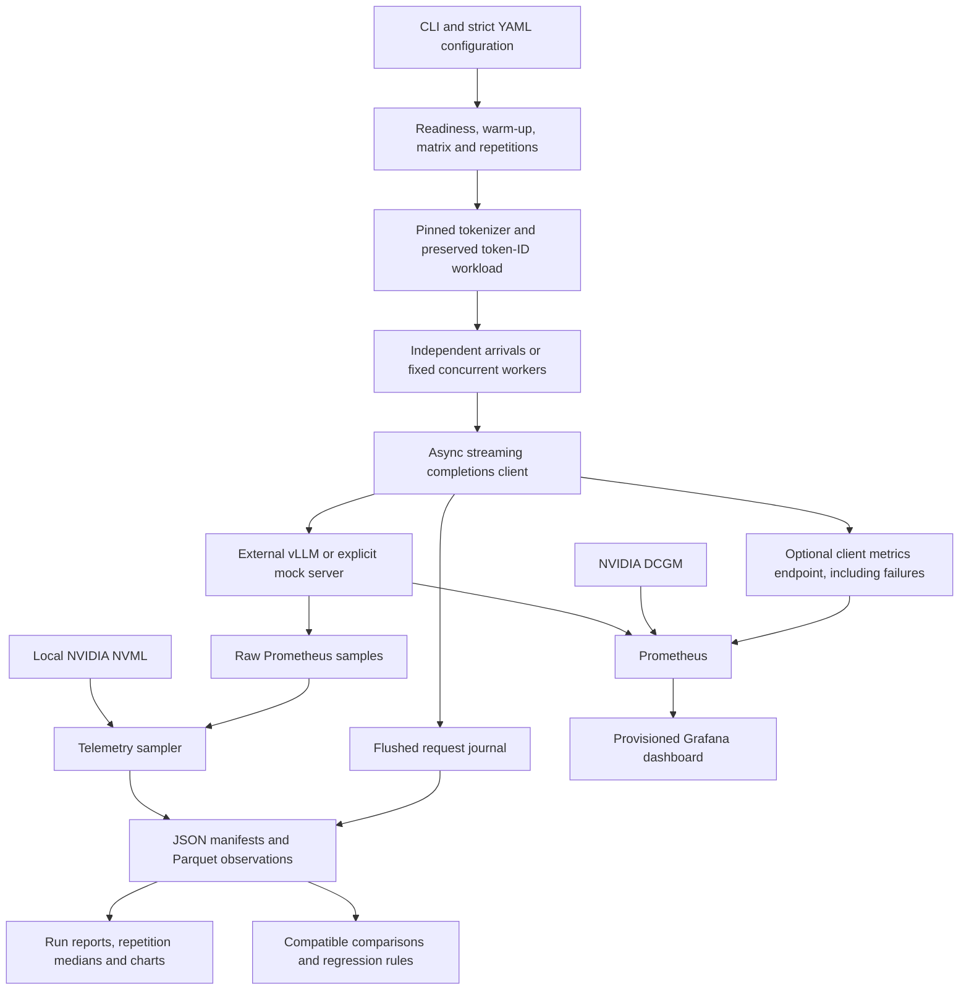

# Architecture

`config.py` validates before requests run. `workload.py` creates deterministic prompts independent of concurrency and server variant. `scheduler.py` bounds workers and pending work without coupling open-loop arrivals to completions. `client.py` decodes SSE and maintains one result per planned request. `controller.py` owns resources and finalizes manifests on failure or interruption. `telemetry.py` records raw metric samples and measurement errors. `analysis.py` enforces comparison rules; `reporting.py` regenerates artifacts without contacting the model.

vLLM stays an external engine. The controller verifies health and model identity, but cannot prove the weights revision or flags of an arbitrary remote server. Launch/inspect provenance is an operator responsibility, represented separately in the manifest. The benchmark does not provision cloud instances, launch shell commands from YAML, or modify vLLM internals.

One HTTP pool reserves additional connections for readiness and telemetry so they do not compete for the worker limit. `trust_env=False` prevents an ambient proxy from altering local experiment traffic. API tokens are loaded from a named environment variable and are not serialized into manifests.
